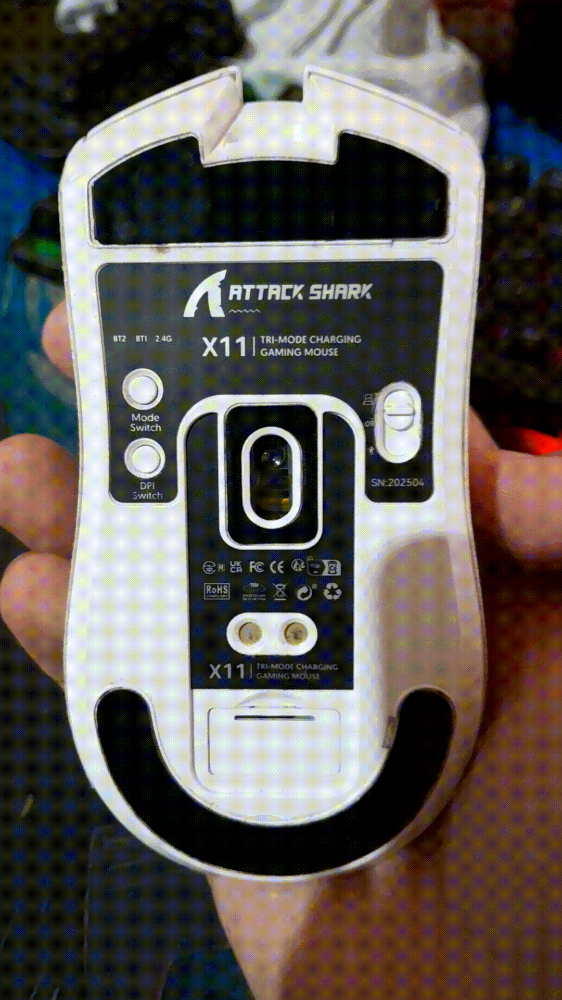

# Profile Settings

> [!TIP]
> To better understand this documentand this document, read the `README.md` located in the root of this directory first.

This document explains how to read and write the device's profile configuration.

## Overview

This protocol allows configuring how many profiles are available on the device and also allows switching between them.

## Writing Profile Settings

| Offset | Description       | Default Example |
|--------|-------------------|-----------------|
| 0      | Report Id         | `0x0c`          |
| 1      | Packet Length     | `0x0a`          |
| 2      | Current Profile   | `0x01`          |
| 3      | `(~byte2 & 0xff)` | `0xfe`          |
| 4      | Max Profiles      | `0x01`          |
| 5      | `(~byte4 & 0xff)` | `0xfe`          |
| 6      | Padding           | `0x00`          |
| 7      | Padding           | `0x00`          |
| 8      | Padding           | `0x00`          |
| 9      | Padding           | `0x00`          |

When operating in wired mode, the padding bytes are not sent.

It is not recommended to use a profile ID higher than 5, as this appears to be the firmware limit; doing so may also
cause unintended behavior.

## Reading Profile Settings

| Offset | Description       | Default Example |
|--------|-------------------|-----------------|
| 0      | Report Id         | `0x0c`          |
| 1      | Packet Length     | `0x0a`          |
| 2      | Profile Id        | `0x01`          |
| 3      | Current Profile   | `0x04`          |
| 4      | `(~byte2 & 0xff)` | `0xfb`          |
| 5      | Max Profiles      | `0x05`          |
| 6      | `(~byte4 & 0xff)` | `0xfa`          |
| 7      | Padding           | `0x00`          |
| 8      | Padding           | `0x00`          |
| 9      | Padding           | `0x00`          |

### Offset 2

Note that the profile ID is returned. However, this seems somewhat redundant. I believe this is because all settings are
literally stored in profiles, so global settings, such as those related to this protocol, are simply stored in profile
`0x01`. This is why profile `0x01` is always returned.

Even if you pass a parameter to `getFeatureReport`, the returned profile ID may match the one you selected, but the
remaining bytes are identical. In other words, ignore this byte.

## Macros

It is worth mentioning `FirmwareAction.PROFILE_CYCLE` and its variants.

For these macros to be practically useful, the additional profiles must first be initialized, and the same
profile-switching macro must be assigned to the corresponding button in each profile.

Otherwise, once the user switches to another profile, the button configuration from the previous profile is no longer
active. If the destination profile does not contain the same profile-switching macro, the user may effectively become
stuck on that profile.

Therefore, the same profile-switching macro should be written to the same button in every profile that participates in
the profile cycle.

Another observable behavior is that when the active profile is changed using `FirmwareAction.PROFILE_CYCLE` or one of
its variants, the LEDs on the bottom of the mouse blink, as shown in the GIF below:

Macros such as `FirmwareAction.PROFILE_UP` and `FirmwareAction.PROFILE_DOWN` do not wrap around the available profile
range.

In other words, once either macro reaches the first or last available profile, it will not continue by wrapping to the
profile at the opposite end of the range.

Another thing I noticed is that, for example, if you are on profile `0x05` and try to go down to profile `0x01` using
the `FirmwareAction.PROFILE_DOWN` macro, for some reason it isn't possible; you can only go down as far as profile
`0x02`; that’s quite strange.

## Messages

[See more in profile-changed.md](../messages/profile-changed.md)
